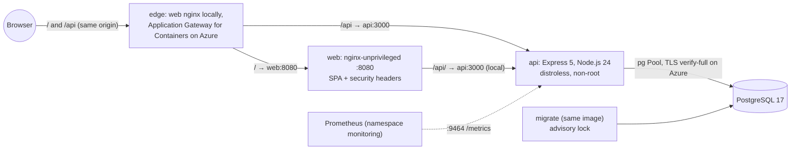

# dx02v2

Application half of the Azure DevOps lab: a small message board (Express 5 API, React 19 page, PostgreSQL 17) with containers, Kubernetes manifests and a kind end-to-end test.

[](https://github.com/maringelix/dx02v2/actions/workflows/ci.yml)

[Português](README.pt-BR.md)

## What is this

A public, educational lab you can clone or fork to learn how a small web app is built, tested,
packaged and deployed to Kubernetes safely. Everything is proven by a local harness that needs no
cloud account: lint, type checks, unit and integration tests against a real PostgreSQL, image builds
with a vulnerability gate, and an end-to-end test on a local kind cluster. The Azure path (AKS built
by `tx02v2`, traffic through Application Gateway for Containers) is prepared but **has never run in
the cloud** — the status matrix says exactly what is proven and how.

This repository runs the same application as `dx01v2` (the AWS pair), so the comparison between
clouds stays fair: only the deploy target changes. How the two stay in sync is in
[docs/ARQUITETURA.md](docs/ARQUITETURA.md).

The lab family (v2):

| Repository | Cloud | Role | Status |
|---|---|---|---|
| [`tx01v2`](https://github.com/maringelix/tx01v2) | AWS | infrastructure (Terraform, EKS, RDS, platform layer) | see its status matrix |
| [`dx01v2`](https://github.com/maringelix/dx01v2) | AWS | application (the same app as this repository) | see its status matrix |
| [`tx02v2`](https://github.com/maringelix/tx02v2) | Azure | infrastructure (Terraform, AKS, PostgreSQL Flexible Server, Application Gateway for Containers, platform layer) | sibling of this repository, see its status matrix |
| `dx02v2` (this repo) | Azure | application (built against `docs/CONTRATO.md`) | see status matrix |
| [`tx03v2`](https://github.com/maringelix/tx03v2) | GCP | infrastructure (Terraform, GKE Autopilot, Cloud SQL, Cloud Armor) | see its status matrix |
| [`dx03v2`](https://github.com/maringelix/dx03v2) | GCP | application (the same app as this repository) | see its status matrix |

## Status matrix

| Capability | Status | Evidence |
|---|---|---|
| Lint, formatting and type checks (eslint, prettier, tsc for `api` and `web`) | `verified in CI` | `make static` (`eslint`, `prettier`, `typecheck:*`); CI job `static` |
| Dockerfiles, workflows and scripts (hadolint, actionlint, shellcheck) | `verified in CI` | `make static` (`hadolint`, `actionlint`, `shellcheck`) |
| Kubernetes manifests: kustomize render + kubeconform strict (local, azure, azure-waf) with Gateway API and Application Gateway for Containers schemas generated from the pinned ALB Controller CRDs, contract and hardening assertions, trivy config | `verified in CI` | `make static` (`crd-schemas`, `kubeconform`, `contract-app`, `trivy-config`) |
| Secret scan and repository policies (no real identifiers or GUIDs, pinned actions and images, v1 regressions, no leftovers of the AWS path) | `verified in CI` | `make static` (`gitleaks`, `policy-*`, `repo-structure`, `version-consistency`) |
| API unit + integration tests against a real PostgreSQL 17 (coverage gate: lines >= 80 %, branches >= 70 %) | `verified in CI` | `make test` (`test:api`); CI job `test` |
| Web tests with Testing Library + jsdom (coverage gate: lines >= 70 %) | `verified in CI` | `make test` (`test:web`); CI job `test` |
| Images: build, numeric non-root user, no npm or shell in the API runtime, trivy HIGH/CRITICAL gate | `verified in CI` | `make build`; CI job `images` |
| Compose stack (PostgreSQL → migrate → api → web on 127.0.0.1) + smoke test | `verified locally` | `scripts/dev-env.sh`, `scripts/compose-smoke.sh` (manual, not part of CI) |
| kind end-to-end: Pod Security `restricted`, smoke test through nginx, NetworkPolicy enforcement | `verified in CI` | `make e2e` (`scripts/e2e-kind.sh`); CI job `e2e` |
| Azure deploy (ACR push, AKS of tx02v2, ExternalSecrets from Key Vault, Application Gateway for Containers + WAF policy, smoke test through it) | `not run in the cloud (v2)` | `.github/workflows/deploy-azure.yml`, `scripts/deploy-azure.sh`, `docs/RUNBOOK.md` |
| HTTPS on the Application Gateway for Containers listener | `planned` | needs a TLS Secret; outside contract v1 (`docs/CONTRATO.md`) |
| Repository settings as code (ruleset, environment `lab`) | `verified locally` | `scripts/repo-guardrails.sh` applied; read back with `gh api` on 2026-10-13 (`docs/PUBLICACAO.md`) |
| Overlay `local-platform` for the tx02v2 local lab: kustomize render + kubeconform strict, assertions against the local contract and the kinds of the AppProject `dx02v2`, five alert rules tested with promtool | `verified in CI` | `make static` (`kubeconform`, `contract-app`, `promtool-rules`) in a Linux container; CI job `static` |
| **The app on the full local platform of tx02v2** (kind + emulated ACR, PostgreSQL Flexible Server, object storage, load balancer, git server): images to the lab registry, GitOps with Argo CD (Synced, Healthy, self-heal) | `verified in CI` | `make e2e-platform` (`scripts/deploy-local.sh`, `scripts/e2e-platform.sh`, `docs/LAB_LOCAL.md`); CI job `e2e-platform` |
| HTTPS through the emulated load balancer and an Istio Gateway (cert-manager, lab CA), smoke test from outside the mesh (`SMOKE_EDGE=istio`); database TLS `verify-full` | `verified in CI` | `make e2e-platform` (probe `smoke`) |
| Istio ambient: mTLS `STRICT`, `AuthorizationPolicy` by identity, NetworkPolicies with HBONE; Prometheus, Grafana dashboard, Loki; Gatekeeper, Trivy Operator, HPA 2-4; database backup + restore drill; chaos experiment | `verified in CI` | `make e2e-platform` (probes `mesh`, `observability`, `trivy`, `hpa`, `backup`, `chaos`) |

`verified in CI` rows run on every pull request, on every push to `main` and weekly (CI jobs in the
Evidence column); the compose row is verified locally only. The Azure row changes only with a
`cloud_run_report` issue (date, location, commits, cost, smoke output, leftovers).

## Architecture



- Local (compose) and kind: one reverse proxy (web nginx) in front of the API (`TRUST_PROXY_HOPS=1`).
- Azure: Application Gateway for Containers (with the WAF policy of tx02v2) routes `/api` to the API
  and `/` to the web through Gateway API; it appends the client address to `X-Forwarded-For`, so
  there is still exactly one trusted hop. Secrets come from Key Vault through External Secrets; the
  namespace, identities, AGC, PostgreSQL and the platform layer belong to tx02v2.
- Design decisions, diagrams per environment, the dx01v2 ↔ dx02v2 and v1 → v2 tables:
  [docs/ARQUITETURA.md](docs/ARQUITETURA.md).

## Quick start (free, local)

You need Docker and either the devcontainer or Linux/WSL 2 with bash >= 4.4, Node.js 24 (`.nvmrc`),
curl, unzip, xz, git and make.

```bash
git clone https://github.com/maringelix/dx02v2.git && cd dx02v2
make tools                     # pinned tools into .tools/, SHA256-verified
HARNESS_STRICT=1 make verify   # static checks + tests (starts a throwaway PostgreSQL in Docker)
make build                     # both images + trivy gate
make e2e                       # kind cluster dx02v2-e2e: deploy, smoke test, NetworkPolicy probes
```

Run the app itself:

```bash
scripts/dev-env.sh                                  # .env with random secrets (gitignored)
docker compose -p dx02v2-dev up -d --build --wait   # http://127.0.0.1:8080
scripts/compose-smoke.sh                            # same smoke test as kind and Azure
docker compose -p dx02v2-dev down -v
```

On Windows or macOS, open the folder in the devcontainer (`.devcontainer/devcontainer.json`, with
Docker-in-Docker); it runs `make tools` for you. Nothing here touches Azure. API reference with curl
examples: [docs/API.md](docs/API.md).

## Cloud path (costs money)

**Cost first:** the app runs on the tx02v2 lab, and its biggest item is Application Gateway for
Containers with the WAF: about US$0.28 per hour (one frontend, one association, about one capacity
unit; US$0.155 per hour without the WAF), that is about US$204 per month if forgotten, on top of the
AKS nodes and PostgreSQL. Reference list prices from the Azure Retail Prices API (eastus2,
2026-10-11); see the [tx02v2 cost doc](https://github.com/maringelix/tx02v2/blob/main/docs/CUSTOS.md)
and the official calculator. Use a dedicated subscription with a budget and destroy on the same day.

Follow [docs/RUNBOOK.md](docs/RUNBOOK.md): tx02v2 bootstrap/apply/platform → GitHub variables of
dx02v2 → `deploy-azure` workflow (or `scripts/deploy-azure.sh`) → smoke test through Application
Gateway for Containers → tx02v2 destroy + leftover check → `cloud_run_report` issue.

## Harness

| Target | What it runs | When |
|---|---|---|
| `make help` | lists the targets | any time |
| `make tools` | `scripts/install-tools.sh`: trivy 0.75.0, hadolint 2.15.1, actionlint 1.7.12, shellcheck 0.11.0, kubeconform 0.8.0, gitleaks 8.30.1, kind 0.33.0, kubectl 1.36.5, kubelogin 0.2.21, promtool 3.15.0 | once, and after a tool bump |
| `make static` | `scripts/harness.sh static` | before every push |
| `make test` | `scripts/harness.sh test` (real PostgreSQL 17: `DB_*` or a throwaway container) | before every push |
| `make verify` | static + test | before every PR |
| `make build` | `scripts/harness.sh build`: npm build, images, image policy, trivy gate | when code, Dockerfiles or dependencies change |
| `make e2e` | `scripts/harness.sh e2e`: kind cluster, smoke test, NetworkPolicy probes | when manifests, images or the app change |
| `make e2e-platform` | `scripts/harness.sh platform`: the app on the full tx02v2 local platform (clones tx02v2 at `deploy/local/tx02v2.ref`), always torn down (CI job `e2e-platform`) | manifest, image or app changes; needs Docker with 8 GB |
| `make all` | every stage | before a release-like merge |
| `make clean` | removes `.tools/`, build output, coverage, `node_modules` and scratch data | — |

`scripts/harness.sh list` prints every check. Details: [docs/HARNESS.md](docs/HARNESS.md).

## Docs

All docs are in Brazilian Portuguese.

| Doc | Content |
|---|---|
| [docs/ARQUITETURA.md](docs/ARQUITETURA.md) | diagrams (local, kind, Azure), decisions, dx01v2 ↔ dx02v2, v1 → v2 |
| [docs/API.md](docs/API.md) | endpoints, errors, curl examples |
| [docs/CONTRATO.md](docs/CONTRATO.md) | tx02v2 ⇄ dx02v2 contract v1 (app side; source of truth in tx02v2) |
| [docs/RUNBOOK.md](docs/RUNBOOK.md) | local development, compose, kind e2e, Azure deploy |
| [docs/LAB_LOCAL.md](docs/LAB_LOCAL.md) | the app on the tx02v2 local platform (GitOps deploy, probes, limits) |
| [docs/GUARDRAILS.md](docs/GUARDRAILS.md) | rules, enforcement, exceptions, limits |
| [docs/HARNESS.md](docs/HARNESS.md) | checks, strict mode, troubleshooting |
| [docs/SUSTENTACAO.md](docs/SUSTENTACAO.md) | routines, end-of-support calendar, update procedures, parity with dx01v2 |
| [docs/PUBLICACAO.md](docs/PUBLICACAO.md) | checklist to make the repository public |

## Contributing

Read [CONTRIBUTING.md](CONTRIBUTING.md) and [AGENTS.md](AGENTS.md) (also for humans). Security
issues: [SECURITY.md](SECURITY.md).

## License

[MIT](LICENSE) — Copyright (c) 2025-2026 Bruno Maringeli.
