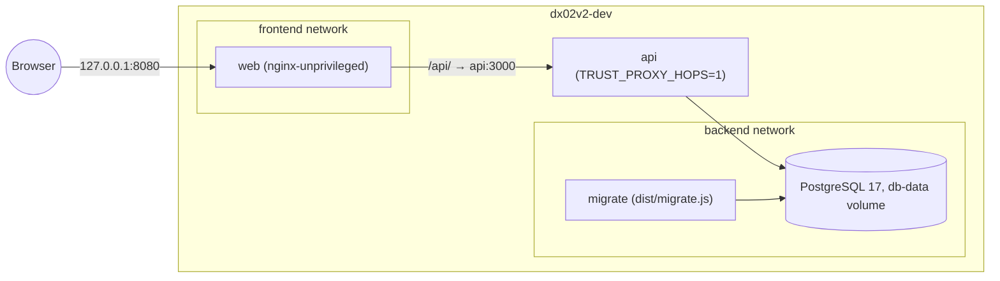
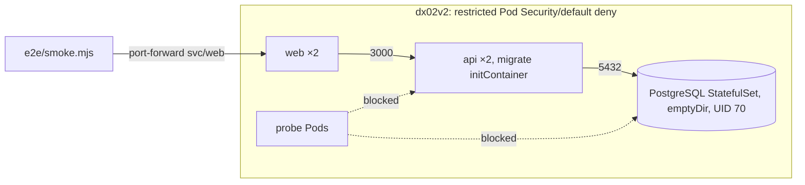
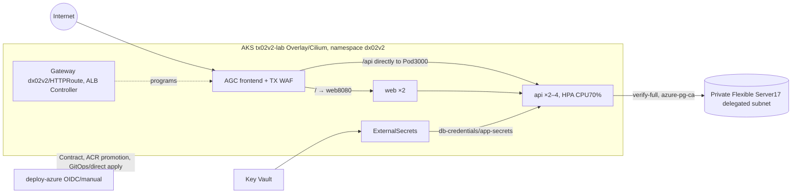

# dx02v2 architecture

Application assembly in Compose/kind/AKS, design decisions, AWS pair differences
(dx01v2) and changes since Azure v1 (dx02). Infrastructure interface: CONTRACT.md;
endpoints: API.md.

## The application is the same as dx01v2

Design decision dated 2026-10-11: each cloud pair has an application repository,
but all three run the **same app** for a fair comparison. This repository began
as all tracked dx01v2 files at commit 22e69c4 (maringelix/dx01v2), changing deployment
target from TX01 EKS to TX02 AKS. API/page/migrations/tests/smoke/base/local
overlay have equivalent behavior. Differences are listed below; quarterly
parity compares api/web/e2e and ports fixes (MAINTENANCE.md).

## Components

| Component | Purpose | Digest-pinned image |
|---|---|---|
| api | Express 5/strict TypeScript ESM on Node 24: message board, probes, separate metrics port | Build node:24-alpine3.24; runtime gcr.io/distroless/nodejs24-debian13:nonroot, UID 65532, no shell/npm |
| migrate | Same API image, dist/migrate.js applies numbered SQL under advisory lock | API image |
| web | React 19/Vite 8 served by nginx; /api proxy | Build node:24-alpine3.24; runtime nginxinc/nginx-unprivileged:1.30-alpine-slim, UID 101/8080, no image-filter/xslt/geoip/njs modules |
| Database | PostgreSQL 17 | Local/kind postgres:17-alpine; Azure TX private Flexible Server17 |

## Local Compose (dx02v2-dev)

db healthcheck → successful migrate → API healthy /readyz → web.
Only web is published, loopback. All containers use read-only root filesystem,
cap_drop ALL/no-new-privileges; dev-env.sh generates .env secrets.

## kind (make e2e)

One Kubernetes 1.36 node (kind-config), kind-loaded images/imagePullPolicy Never,
random script-created Secrets. Default kindnet enforces NetworkPolicy since
kind 0.24.0 via kube-network-policies; e2e proves allow/deny paths.

## Azure AKS (not run in the cloud (v2))

TX owns namespace/deployer RBAC/ClusterSecretStore/ALB Controller, AGC/frontend/
association/WAF, Key Vault/PostgreSQL. App owns Gateway/HTTPRoute/health policies,
optional WebApplicationFirewallPolicy, ExternalSecrets/HPA/subnet NetworkPolicies.
App Configuration supplies images/AGC/WAF/CIDRs through params.env and kustomize
replacements. Overlay routing extends into AGC subnet; AGC forwards directly to
Pods (official "Container networking with Application Gateway for Containers",
checked 2026-10-11). Policies therefore allow AGC subnet rather than node subnet.

Full adds ambient and an internal canary HTTPRoute: /variant splits stable/canary,
/fail has bounded retry, and 5xx ejects canary. Allowed mesh-probe and denied
mesh-intruder use separate ServiceAccounts. Local-platform uses the same
manifests on TX kind.

## Decisions

1. **One process per container.** API/web have separate images/Deployments,
   without nginx/Node and shell traps sharing a container.
2. **Distroless API.** nodejs24-debian13:nonroot has no shell/npm; Debian12 stopped
   at Node 24.14.0. Compose healthcheck uses /nodejs/bin/node -e fetch(...).
3. **Owned nginx configuration.** server_tokens off, IPv4/IPv6, local /healthz,
   standard forwarding headers, SPA fallback and long hashed-asset cache.
   Security snippet included in every location. HSTS only with forwarded HTTPS;
   AGC core is HTTP, full now provides ACME HTTPS. AGC sets forwarded protocol.
4. **Count trusted proxy hops.** TRUST_PROXY_HOPS=1 in Compose/kind/Azure:
   nginx or AGC is exactly one proxy before API. AGC appends the connecting IP to
   X-Forwarded-For without a space (198.51.100.7,203.0.113.9; components docs
   checked 2026-10-11). One trusted hop selects the last address, ignoring forged
   entries on the left. Extra Azure integration case covers that format; smoke
   proves429 despite a different forged address per request.
5. **In-memory write limit.** express-rate-limit uses req.ip, default 10/minute
   before validation. N replicas permit up to N times the limit. Shared Redis
   excluded for cost/complexity.
6. **JSON errors and limits.** error code/message/requestId; API 10kb/nginx64k
   body limits,415 for non-JSON,503 db_unavailable without internal detail.
7. **Startup validation.** zod environment schema; APP_ENV=lab only accepts
   verify-full with DB_SSL_CA_FILE.
8. **Recoverable database connection.** Lazy pg pool,3s connect/5s statement
   timeout. /readyz SELECT1 deadline1s, returns200 after database recovery.
9. **Explicit migrations.** Numbered SQL, transaction/file, pg_advisory_lock,
   schema_migrations checksum; migrate initContainer/Compose service.
10. **Graceful shutdown.** SIGTERM → readiness 503 → server.close → pool.end →
    spans flush max5s (unavailable Collector does not fail shutdown); forced
    exit after SHUTDOWN_TIMEOUT_MS10s; preStop sleep5s.
11. **Separate metrics.** OpenMetrics9464/trace_id exemplar; neither web nor
    Gateway exposes it. NetworkPolicy allows monitoring namespace; full
    platform installs Prometheus, core alone does not.
12. **AGC Gateway API.** ingress-nginx retired2026-03; AKS NGINX routing support
    ends November2026. GA AGC supports Overlay. Bring-your-own TX provisions
    AGC/frontend/association; Gateway uses alb-id annotation/spec.addresses
    alb-frontend type (official guides checked 2026-10-11). Longest-match /api
    goes directly API, / goes web; each Service has health policy (/readyz,
/healthz), probes originate from AGC subnet.
13. **Optional WAF component.** azure-waf/full uses Gateway-wide policy when
    waf/policy-id !=none; azure/full deletes old policy for none. AGC accepts
    DRS 2.1 in same subscription/region; deploy checks subscription.
14. **Kustomize components.** Neutral base; local kind; core azure/azure-waf;
    full counterparts add mesh-full; local-platform uses TX kind mesh. HPA owns
    Azure API replicas, removing spec.replicas. CI renders all example parameters.
15. **Generated pinned CRD schemas.** Strict kubeconform validates Gateway,
    HTTPRoute, HealthCheckPolicy/WAF against digest-pinned ALB1.12.2 CRD image,
    Gateway API 1.5.1 standard. Pinned datreeio had experimental1.6.1, different
    from core cluster. Two AGC schemas match catalog63669a5 byte-for-byte,
    validating conversion; ExternalSecret still uses catalog.
16. **Pod security.** Restricted admission, no ServiceAccount token, default
    deny NetworkPolicies with explicit necessary paths.
17. **Stable image tags.** Full commit SHA in ACR. ACR does not enforce immutable
    tags: deploy queries only app tag, checks existing imageID, otherwise pushes
    verified image, never overwrites a different commit-tag image. Standard ACR
    uses separate Repository Writer ABAC conditions, no catalog listing.
    Local tags e2e (kind)/local (Compose).
18. **Attested promotion without rebuild.** deploy-azure verifies GHCR release,
    promotes same image to ACR, signs source/destination digest attestation.
    Full Kyverno requires it before Pod admission. Profiles core/full;
    deploy modes auto/gitops/push.
19. **Verified database roots.** Deploy downloads three contract roots, rejects
    mismatching SHA-1 thumbprints before azure-pg-ca; verify-full checks chain/name.
20. **One smoke across environments.** Node-only smoke on Compose/kind/AGC:
    nginx edge expects web CSP on /api and echoed requestID; agc expects API CSP
    and per-request AGC GUID.70KB body gets413 from nginx64k or API behind AGC
    (WAF inspects128KB).
21. **OpenTelemetry without loader.** Manual SERVER request/CLIENT query spans
    using official SDK/API, avoiding ESM autoinstrumentation loader hooks.
    OTLP/HTTP to platform Collector, disabled when endpoint unset; cloud Insights,
    W3C context, trace_id/span_id logs and exemplars. Health endpoints create no
    span. Same application code as DX01.

### Known Azure runtime risks

- **Keep-alive:** API idle timeout 65s follows nginx60s. AGC docs list HTTP idle
  timeout 5min without stating backend-Pod scope. If it applies, requests may hit
  just-closed API connections, causing occasional502/503. Check first cloud run;
  changing timeout changes app and requires parity ports.
- **Managed WAF:** smoke stores <b> text. DRS 2.1 should permit it, but only a
  real Prevention-mode run proves behavior.
- **Policy status:** deploy waits Gateway Programmed (documented) and WAF
  Accepted (CRD condition type); exact AGC policy-status semantics are undocumented.

## dx01v2 ↔ dx02v2

| Aspect | AWS | Azure |
|---|---|---|
| api/web/migrations | commit 22e69c4 plus OTel2026-10-14 | Same; repo names/info/log realm/advisory key/span service dx02v2-api/comments differ |
| Traces | TX Collector → X-Ray | TX Collector → Insights through Entra |
| Tests | Baseline suite 22e69c4 | Same names/example path adjusted plus AGC no-space XFF integration case |
| Smoke | SMOKE_BEHIND_WAF=1,403 above 8KB | SMOKE_EDGE=agc,API CSP/AGC requestID/API 413; Compose/kind preserve original behavior with exact API CSP |
| Cluster | EKS 1.36/access entries | AKS 1.36/Entra, az get-credentials/kubelogin |
| Edge | LBC ALB Ingress,target-type ip,WAFv2 | ALB Controller AGC/Gateway API/optional DRS 2.1 policy |
| Health | Service annotations | HealthCheckPolicy/Service |
| Secrets | Secrets Manager/ESO aws-secrets-manager | Key Vault/ESO azure-key-vault, JSON properties |
| Contract | See current TX01 CONTRACT | App Configuration17 keys tx02v2/lab/*; historical snapshot had15 |
| Registry | ECR immutable | ACR Standard/repository ABAC, deploy refuses overwrite; historical Basic replaced |
| DB TLS | Region RDS bundle | Three-root azure-pg-ca, checked SHA-1 |
| Network | VPC CIDR for ALB/RDS | AGC/24 and delegated PostgreSQL subnet |
| Policy enforcement | VPC CNI | Overlay/Cilium |
| HTTPS | AWS ACM overlay | Full cert-manager/Let's Encrypt AGC Secret; core HTTP |
| GitHub OIDC | IAM deploy role | Federated managed identity, azure/login3.1.0 |
| Deploy order | Contract/images/kubeconfig | Contract/kubeconfig+RBAC/ACR/images, token-sensitive steps first |
| Tools | Shared harness tools | kubelogin0.2.21 added |
| Schemas | ESO catalog | ESO catalog plus generated ALB/Gateway/AGC schemas |
| New checks | — | crd-schemas/policy-cloud (reject AWS path), GUID/suffix identifier guards |

## v1 → v2

| v1 Azure problem | v2 response | Evidence |
|---|---|---|
| Trivial status page; DB/stats cards never rendered; no writes | Real create/list/delete board with page/API tests against PostgreSQL | test:web/test:api/smoke |
| Unauthenticated/unlimited POST /api/visit stored raw user_agent | IP rate limit/zod/no stored header data; DELETE admin token | rate-limit/validation/messages/admin-auth/smoke |
| Fixed localhost CORS | Same-origin nginx/AGC, no CORS | policy-app |
| Cached healthy DB flag; same liveness/readiness | Independent healthz/readyz SELECT1 each call | readiness tests/contract probes |
| Docker HEALTHCHECK wrong port | Correct Compose ports/Kubernetes contract | Compose smoke/contract |
| Error handler always500 | Correct400/401/404/413/415/429/500/503 JSON | messages/smoke |
| Validator500 characters/column255 | Matching author40/text280 | validation/migration |
| Wrong client IP/no trust proxy | Counted hops including AGC format | policy-app/rate-limit/smoke |
| No server.close | SIGTERM/readiness/server.close/pool.end | server test |
| Divergent3000/5000/80 and three Deployments | One base/overlays, checked names/ports | contract-app |
| Invalid Compose/fixed trustServerCertificate false | Tested Compose; local disable/cloud verify-full | local Compose smoke/config tests |
| Red backend CI for months, missing MSSQL_SA_PASSWORD | No cloud CI secrets; disposable DB/strict mode | workflow policy |
| Lint only npm install | Type-aware eslint/prettier/strict tsc | eslint/prettier/typecheck |
| expect(true).toBe(true) | Real tests/coverage: API>=80% lines,>=70% branches,web>=70% | test:api/web |
| Nonexistent azure/login SHA | gh api dereferenced tag and fullSHA format | policy-workflows/MAINTENANCE5.8 |
| Long-lived principal secrets/input image_tag shell insertion | OIDC only; current workflow has validated release/profile inputs, rejects creds/client-secret and unsafe shell interpolation | policy-workflows |
| NetworkPolicy without from, any-IP egress | Deny-all/explicit AGC and DB subnet rules | contract/kind probes |
| HTTP ingress sent preload HSTS | Only HTTPS sends HSTS; full implements AGC HTTPS, cloud unverified | policy-app/smoke |
| unsafe-inline style returned | Strict CSP/no inline scripts/styles | policy-app/smoke |
| Public970KB sourcemap | Vite sourcemap false/no map in web image | image-policy:web |
| UTF16 manifests | UTF8/noBOM/LF | repo-structure |
| EOL Node 20/Alpine3.19/fixable CRITICAL | Node 24/Alpine3.24/distrolessDebian13/Trivy gate | version-consistency/trivy-image |
| False README/CHANGELOG Prometheus/image-size/modules claims | Evidence/status matrix | repo-structure/review |
