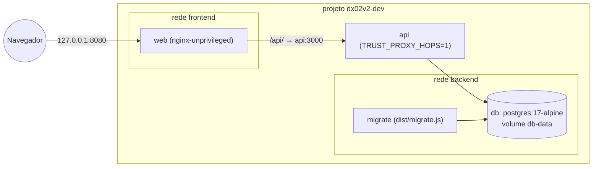
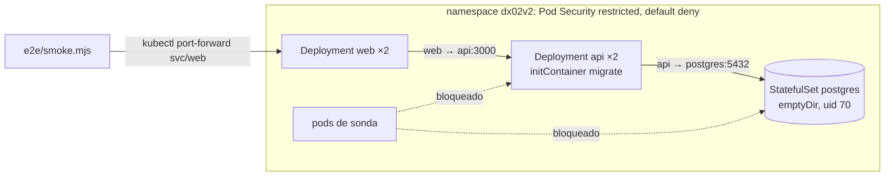
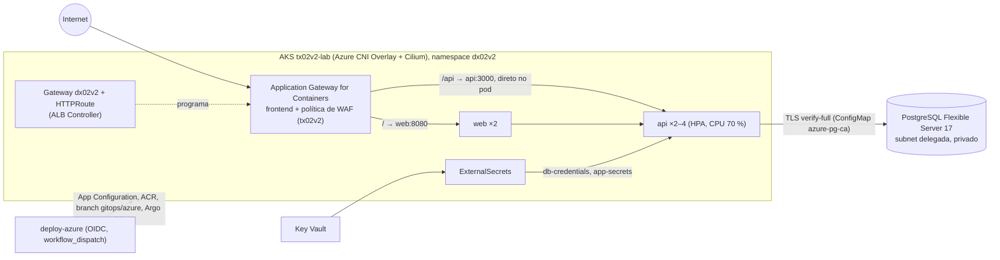

# Arquitetura do dx02v2

Como o app é montado em cada ambiente (compose, kind, AKS), as decisões de design, o que difere do
par da AWS (`dx01v2`) e o que mudou em relação ao v1 (`dx02`). O contrato com a infraestrutura está
em `docs/CONTRATO.md`; os endpoints em `docs/API.md`.

## O app é o do dx01v2

Por decisão de projeto (2026-10-11), cada par de nuvem tem o seu repositório de aplicação, mas os
três rodam o **mesmo** app, para a comparação entre nuvens ser justa. Este repositório começou como
cópia de todos os arquivos versionados do `dx01v2` no commit `22e69c4` (maringelix/dx01v2) e só o
destino do deploy mudou: o AKS do `tx02v2` no lugar do EKS do `tx01v2`. A API, a página, as
migrações, os testes, o smoke test, a `base` dos manifests e o overlay `local` (kind) têm o mesmo
comportamento; as diferenças estão na tabela "dx01v2 ↔ dx02v2" abaixo, e a rotina trimestral que as
mantém assim está em `docs/SUSTENTACAO.md` (comparar `api/`, `web/` e `e2e/` com o dx01v2 e portar
correções nos dois repositórios).

## Componentes

| Componente | O quê | Imagem (por digest) |
|---|---|---|
| `api` | Express 5 + TypeScript estrito (ESM) no Node.js 24: mural de mensagens, probes, métricas em porta separada | build `node:24-alpine3.24`; runtime `gcr.io/distroless/nodejs24-debian13:nonroot` (uid 65532, sem shell, sem npm) |
| `migrate` | `dist/migrate.js` na mesma imagem da API: aplica `api/migrations/*.sql` sob advisory lock | a da API |
| `web` | página React 19 (Vite 8) servida pelo nginx, que também faz proxy de `/api/` para a API | build `node:24-alpine3.24`; runtime `nginxinc/nginx-unprivileged:1.30-alpine-slim` (uid 101, porta 8080; sem os módulos image-filter/xslt/geoip/njs) |
| banco | PostgreSQL 17 | local/kind: `postgres:17-alpine`; Azure: PostgreSQL Flexible Server 17 do tx02v2 (acesso privado) |

## Local (compose, projeto `dx02v2-dev`)

`db` (healthcheck) → `migrate` (termina com sucesso) → `api` (healthy em `/readyz`) → `web`. Só o web
é publicado, em 127.0.0.1. Todos com root filesystem somente leitura, `cap_drop: [ALL]` e
`no-new-privileges`; segredos do `.env` gerado por `scripts/dev-env.sh`.

## kind (`make e2e`)

Um nó Kubernetes 1.36 (`kind/kind-config.yaml`); imagens carregadas com `kind load` e
`imagePullPolicy: Never`; Secrets aleatórios criados pelo script. O kindnet, CNI padrão do kind,
aplica NetworkPolicy desde o kind v0.24.0 (kube-network-policies), e o e2e prova isso com sondas
permitidas e bloqueadas.

## Azure (AKS do tx02v2, `não executado em nuvem (v2)`)

O namespace, a RBAC do deployer, o ClusterSecretStore, o ALB Controller, o Application Gateway for
Containers (AGC) com o frontend e a associação, a política de WAF, o Key Vault e o PostgreSQL são do
tx02v2. O app traz Gateway, HTTPRoute, HealthCheckPolicies, a WebApplicationFirewallPolicy
(opcional), ExternalSecrets, HPA e NetworkPolicies por CIDR de subnet (AGC → pods, API → PostgreSQL);
os valores da App Configuration (imagens, ID e frontend do AGC, ID do WAF, CIDRs) entram por um
`params.env` e `replacements` do kustomize. Com Azure CNI Overlay, o domínio de roteamento do overlay
se estende à subnet do AGC, que encaminha direto para os pods (documentação "Container networking
with Application Gateway for Containers", verificada em 2026-10-11) — por isso as NetworkPolicies
liberam a subnet do AGC, e não o nó.

## Decisões

1. **Um processo por container.** API e web em imagens e Deployments separados; nada de nginx e Node
   no mesmo container com um trap de shell.
2. **Runtime distroless da API.** `nodejs24-debian13:nonroot`, sem shell nem npm (a variante
   `debian12` parou no Node.js 24.14.0). O healthcheck do compose é uma linha de Node
   (`/nodejs/bin/node -e fetch(...)`).
3. **nginx próprio no web.** `default.conf` com `server_tokens off`, IPv4 + IPv6, `/healthz` local,
   `/api/` com os cabeçalhos de encaminhamento padrão, fallback de SPA e cache longo para os assets
   com hash. Os cabeçalhos de segurança ficam em um snippet incluído em **cada** `location`. HSTS só
   quando `X-Forwarded-Proto` é `https`; como o listener do AGC é só HTTP (HTTPS `planejado`), nada
   de HSTS na Azure, e o AGC preenche o `x-forwarded-proto` com o protocolo que recebeu.
4. **`trust proxy` como contagem de saltos.** `TRUST_PROXY_HOPS=1` em compose, kind e Azure: há
   exatamente um proxy na frente da API (o nginx, ou o AGC para `/api`). Verificado na documentação
   "Application Gateway for Containers components" (2026-10-11): o AGC acrescenta ao
   `x-forwarded-for` o endereço de quem se conectou a ele, separado por vírgula sem espaço
   (por exemplo `198.51.100.7,203.0.113.9`). Com um salto confiável, `req.ip` é esse último endereço e entradas falsas à
   esquerda são ignoradas; o teste de integração `rate-limit` cobre esse formato (teste a mais em
   relação ao dx01v2) e o smoke prova o 429 com `X-Forwarded-For` falso diferente a cada requisição.
5. **Rate limit de escrita em memória.** `express-rate-limit` por `req.ip`, 10 por minuto por padrão,
   contado antes da validação. Com N réplicas o limite efetivo chega a N vezes; um store
   compartilhado (Redis) ficou de fora por custo e complexidade.
6. **Erros JSON e limites.** Todo erro sai como `{"error":{"code","message","requestId"}}`; corpo até
   10 kb na API (413), 64k no nginx; 415 para corpo que não é JSON; 503 `db_unavailable` quando o
   banco cai, sem detalhes internos.
7. **Configuração validada na partida.** Um schema zod sobre o ambiente; com `APP_ENV=lab`, só
   `DB_SSL_MODE=verify-full` com `DB_SSL_CA_FILE` é aceito.
8. **Banco que se recupera.** Pool `pg` preguiçoso (conexão em 3 s, `statement_timeout` 5 s);
   `/readyz` faz `SELECT 1` com limite de 1 s e volta a 200 quando o banco volta.
9. **Migrações explícitas.** Arquivos SQL numerados, uma transação por arquivo, `pg_advisory_lock` e
   checksum em `schema_migrations`. Rodam no initContainer `migrate` e no serviço `migrate` (compose).
10. **Desligamento gracioso.** SIGTERM → `/readyz` 503 → `server.close()` → `pool.end()` → flush dos
    spans pendentes (no máximo 5 s; um Collector fora do ar não transforma o desligamento em falha);
    saída forçada após `SHUTDOWN_TIMEOUT_MS` (10 s); `preStop` com a ação `sleep` de 5 s.
11. **Métricas separadas.** `/metrics` na porta 9464, no formato OpenMetrics (o exemplar leva o
    `trace_id` da requisição); nem o web nem o Gateway expõem essa porta; a NetworkPolicy só aceita o
    namespace `monitoring` (não há Prometheus neste lab).
12. **Gateway API no Application Gateway for Containers.** O ingress-nginx upstream foi aposentado em
    2026-03 e o add-on de roteamento NGINX do AKS só tem suporte até novembro de 2026; o AGC é GA,
    fala Gateway API e funciona com Azure CNI Overlay. Modo "bring your own": o tx02v2 cria o AGC, o
    frontend e a associação; o Gateway aponta para eles com a anotação `alb.networking.azure.io/alb-id`
    e `spec.addresses` do tipo `alb.networking.azure.io/alb-frontend` (guias oficiais, verificados em
    2026-10-11). A HTTPRoute manda `/api` direto para a API (o caminho mais longo vence na Gateway
    API) e `/` para o web; uma HealthCheckPolicy por Service define os health probes (`/healthz`,
    `/readyz`), que saem da subnet do AGC como o tráfego.
13. **WAF como componente opcional.** `components/azure-waf` (WebApplicationFirewallPolicy no Gateway
    inteiro) só entra no overlay `azure-waf`, escolhido pelo deploy quando `waf/policy-id` não é
    `none`; com `none`, o overlay `azure` e o deploy apaga uma política antiga. O AGC só aceita
    políticas DRS 2.1 da mesma assinatura e região (o deploy confere a assinatura).
14. **Kustomize com componentes.** `base` neutra; `overlays/local` (kind) e `overlays/azure` /
    `azure-waf` (componentes `azure` e `azure-waf`). Na Azure o HPA controla as réplicas da API
    (`spec.replicas` removido). O CI renderiza e valida todos os overlays com `params.example.env`.
15. **Schemas dos CRDs gerados e fixados.** O kubeconform valida Gateway, HTTPRoute, HealthCheckPolicy
    e WebApplicationFirewallPolicy contra schemas gerados por `scripts/update-crd-schemas.sh` a partir
    da imagem de CRDs do ALB Controller 1.12.2 (por digest), que traz a Gateway API v1.5.1 standard:
    o catálogo datreeio fixado tinha a Gateway API 1.6.1 experimental, que não é o que o cluster
    recebe. Os dois schemas do AGC gerados são idênticos byte a byte aos do catálogo no commit
    `63669a5`, o que confirma a conversão; o ExternalSecret continua validado pelo catálogo.
16. **Segurança de pods.** Pod Security `restricted` em todo pod, sem token de service account,
    NetworkPolicies que negam tudo e liberam só o necessário.
17. **Tags de imagem que não mudam.** No ACR, tag = SHA completo do commit. O ACR Basic não tem
    imutabilidade de tags, então o deploy lista as tags antes e **nunca** faz push sobre uma tag que
    já existe (reaproveita a imagem). Localmente a tag é `e2e` (kind) ou `local` (compose).
18. **Tokens Azure no começo do deploy.** O `azure/login` troca o token OIDC do GitHub (válido de 5 a
    10 minutos) por tokens do Entra ID; depois que ele expira, o Azure CLI só reaproveita os tokens
    que já tem (cerca de uma hora). Por isso o deploy lê a App Configuration, gera o kubeconfig
    (`kubelogin convert-kubeconfig -l azurecli`), faz o preflight de RBAC e o login no ACR **antes** de
    construir as imagens — e falha cedo, sem gastar o build, se a plataforma não estiver pronta.
19. **Raízes do TLS do banco conferidas.** O deploy baixa as três raízes do contrato, confere o
    thumbprint SHA-1 de cada uma e recusa qualquer diferença antes de criar o ConfigMap
    `azure-pg-ca`; o `verify-full` confere a cadeia e o nome do servidor.
20. **Um smoke test para todos os ambientes.** `e2e/smoke.mjs` (Node.js puro) roda contra o compose,
    o kind e o AGC, com asserções exatas por borda: `SMOKE_EDGE=nginx` (padrão) espera a CSP do web
    em `/api` e o `X-Request-Id` ecoado; `SMOKE_EDGE=agc` espera a CSP da própria API em `/api` e o
    GUID que o AGC atribui a cada requisição. O corpo de 70 KB recebe 413 nos dois: do nginx (64k) ou,
    atrás do AGC, da própria API (a política de WAF do tx02v2 inspeciona até 128 KB).
21. **Traces com OpenTelemetry, sem loader.** A API cria os próprios spans (SERVER por requisição,
    CLIENT por consulta dentro dela) com a API e o SDK oficiais do OpenTelemetry, em vez da
    auto-instrumentação, que no ESM exige um hook de carregamento de módulos. Spans em OTLP/HTTP para o
    Collector da plataforma do tx02v2 (`OTEL_EXPORTER_OTLP_ENDPOINT`; desligado sem ele), que os grava no
    Application Insights; W3C trace context, e o trace id nos logs (`trace_id`, `span_id`) e nos
    exemplars. As sondas `/healthz` e `/readyz` não geram span. O mesmo código do dx01v2.

### Riscos conhecidos do caminho Azure

- **Keep-alive.** O servidor da API fecha conexões ociosas após 65 s (`keepAliveTimeout`, escolhido
  para o nginx, 60 s). A documentação do AGC lista um "HTTP idle timeout" de 5 minutos sem dizer se
  vale para as conexões com os pods; se valer, uma requisição pode cair numa conexão que a API acabou
  de fechar (502/503 esporádico). Verificar na primeira rodada; a correção (subir o
  `keepAliveTimeout`) mudaria o app e precisaria ir para os dois repositórios.
- **Regras gerenciadas do WAF.** O smoke grava um texto com `<b>`; o DRS 2.1 não deveria tratá-lo
  como XSS, mas só uma rodada real prova (a política fica em modo Prevention).
- **Status das políticas.** O deploy espera `Programmed` no Gateway (documentado) e `Accepted` na
  WebApplicationFirewallPolicy (tipo de condição declarado no CRD); a semântica exata do status das
  políticas do AGC não está documentada.

## dx01v2 ↔ dx02v2

| Aspecto | dx01v2 (AWS) | dx02v2 (Azure) |
|---|---|---|
| App (`api/`, `web/`, migrações) | commit `22e69c4` + traces com OpenTelemetry (2026-10-14) | o mesmo; só nomes (`dx01v2` → `dx02v2`, inclusive `/api/info`, logs, realm, chave do advisory lock e o serviço `dx02v2-api` dos spans) e comentários |
| Traces | Collector do tx01v2 → AWS X-Ray | Collector do tx02v2 → Application Insights (Entra ID) |
| Testes | suíte do commit `22e69c4` | a mesma (nomes e um caminho de exemplo trocados), mais 1 caso de integração (`X-Forwarded-For` sem espaço, formato do AGC) |
| Smoke test | `SMOKE_BEHIND_WAF=1`: 403 do WAF acima de 8 KB | `SMOKE_EDGE=agc`: CSP da API em `/api`, `X-Request-Id` do AGC, 413 da API; compose e kind com as mesmas asserções de antes (a CSP em `/api` agora é exata) |
| Cluster | EKS 1.36 (tx01v2), access entries | AKS 1.36 (tx02v2), Entra ID; kubeconfig via `az aks get-credentials` + `kubelogin` |
| Entrada | Ingress da AWS Load Balancer Controller (ALB, `target-type: ip`) + WAFv2 | Gateway API no Application Gateway for Containers (ALB Controller) + WebApplicationFirewallPolicy opcional (DRS 2.1) |
| Health checks | anotações nos Services | HealthCheckPolicy por Service |
| Segredos | Secrets Manager → ESO (`aws-secrets-manager`) | Key Vault → ESO (`azure-key-vault`), propriedades JSON |
| Parâmetros do contrato | SSM `/tx01v2/lab/*` (10) | App Configuration `tx02v2/lab/*` (15) |
| Registry | ECR, tags IMMUTABLE | ACR Basic, o deploy recusa sobrescrever tags |
| TLS do banco | bundle `rds-ca` da região | ConfigMap `azure-pg-ca`: três raízes com thumbprint SHA-1 conferido |
| NetworkPolicies de borda | CIDR da VPC (ALB e RDS) | subnet do AGC (/24) e subnet delegada do PostgreSQL |
| Enforcement de NetworkPolicy | VPC CNI | Cilium (Azure CNI Overlay) |
| HTTPS | overlay `aws-https` (certificado ACM) | `planejado` (Secret TLS no listener) |
| OIDC do GitHub | papel IAM `dx01v2-gha-deploy` | managed identity `dx02v2-gha-deploy` com credencial federada (`azure/login` v3.1.0) |
| Ordem do deploy | contrato → imagens → kubeconfig | contrato → kubeconfig + preflight de RBAC → ACR → imagens (tokens no começo) |
| Ferramentas do harness | 8 | as mesmas + `kubelogin` 0.2.21 |
| Schemas do kubeconform | catálogo datreeio (ESO) | catálogo datreeio (ESO) + gerados dos CRDs do ALB Controller (Gateway API, AGC) |
| Checks novos | — | `crd-schemas`, `policy-cloud` (nada do caminho AWS), GUIDs e sufixos reais em `policy-identifiers` |

## v1 → v2

Problemas do v1 da Azure (`dx02`) que o v2 não pode repetir:

| Problema no v1 | Como o v2 resolve | Onde é verificado |
|---|---|---|
| Página de status trivial: os cards de banco e estatísticas nunca renderizavam e a tabela não recebia escrita nenhuma | mural de mensagens de verdade (criar, listar, apagar) com testes da página e da API contra um PostgreSQL real | `test:web`, `test:api`, smoke |
| A única rota de escrita (`POST /api/visit`) sem autenticação nem rate limit, e o `user_agent` do cliente gravado como veio | rate limit de escrita por `req.ip`, validação zod, nada de dados de cabeçalho gravados; `DELETE` exige o token de admin | testes `rate-limit`, `validation`, `messages`, `admin-auth`; smoke |
| CORS fixo em localhost | sem CORS: mesma origem (nginx localmente, AGC na Azure) | `policy-app` |
| Health check saudável com o banco fora (flag gravada uma vez na partida) e liveness = readiness | `/healthz` sem dependências (liveness) e `/readyz` com `SELECT 1` a cada chamada (readiness), probes separados | testes `readiness`; `contract-app` (probes) |
| `HEALTHCHECK` do Docker na porta errada | healthchecks do compose nas portas certas; probes do Kubernetes conferidos pelo contrato | smoke do compose; `contract-app` |
| Handler de erro sempre 500 (413 e 400 se perdiam) | erros JSON com o status certo: 400, 401, 404, 413, 415, 429, 500, 503 | teste `messages`; smoke |
| Validador aceitando 500 caracteres numa coluna VARCHAR(255) | limites do zod iguais aos do banco (autor 40, texto 280) | teste `validation`; migração |
| IP do cliente errado (sem `trust proxy`) | `TRUST_PROXY_HOPS` (contagem de saltos), incluindo o formato do AGC | `policy-app`; teste `rate-limit`; smoke |
| Desligamento sem `server.close()` | SIGTERM → readiness 503 → `server.close()` → `pool.end()` | teste `server` |
| Portas divergentes (3000/5000/80) e três Deployments diferentes | uma `base` e overlays; portas e nomes conferidos | `contract-app` |
| `compose` inválido e `trustServerCertificate: false` fixo: a stack local nunca subia | compose testado (`scripts/compose-smoke.sh`); TLS do banco por ambiente (`disable` local, `verify-full` na Azure) | smoke do compose (`verificado localmente`); teste `config` |
| Job de backend do CI vermelho por meses: um segredo (`MSSQL_SA_PASSWORD`) que nunca existiu | o CI não usa segredos; banco descartável no próprio job; `HARNESS_STRICT=1` | `ci.yml`; `policy-workflows` |
| Um job de "lint" que só rodava `npm install` | eslint type-aware, prettier e tsc estrito no harness | `eslint`, `prettier`, `typecheck:*` |
| `expect(true).toBe(true)` | testes contra o app real e limites de cobertura | `test:api` (>= 80 % linhas, >= 70 % branches), `test:web` (>= 70 %) |
| Pin do `azure/login` num SHA que não existia | SHA conferido com `gh api` (tag anotada desreferenciada) e formato exigido pelo harness | `policy-workflows`; `docs/SUSTENTACAO.md` (5.8) |
| Segredos de service principal de longa duração e um input `image_tag` colado no shell | só OIDC (managed identity com credencial federada), workflow sem inputs; o harness recusa `creds:`, `client-secret` e interpolação de inputs | `policy-workflows` |
| NetworkPolicy sem `from` e saída para qualquer IP | deny-all + regras explícitas; na Azure, um CIDR por regra (subnet do AGC, subnet do PostgreSQL) | `contract-app`; sondas do e2e no kind |
| Ingress só HTTP mandando HSTS com preload | HSTS só para requisições HTTPS; HTTPS do AGC `planejado` | `policy-app`; smoke (sem HSTS em HTTP) |
| `style-src 'unsafe-inline'` voltou | CSP estrita sem estilos nem scripts inline | `policy-app`; smoke |
| Sourcemap público de 970 KB | `sourcemap: false` no build do Vite e nenhum `.map` na imagem do web | `image-policy:web` |
| Manifests em UTF-16 | texto UTF-8 sem BOM e LF em todo arquivo do repositório | `repo-structure` |
| Node.js 20 (fim em 2026-04-30) no Alpine 3.19 com CRITICALs corrigíveis | Node.js 24 no Alpine 3.24 e no distroless Debian 13; gate do trivy | `version-consistency`; `trivy-image:*` |
| README/CHANGELOG com afirmações falsas (Prometheus, tamanho de imagem, módulos Terraform) | matriz de status com rótulos e evidência | `repo-structure`; revisão |
